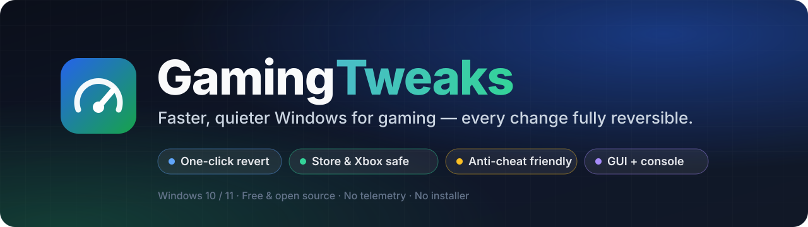
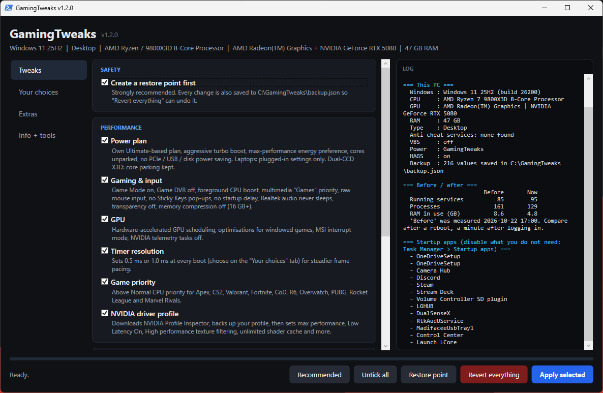

 

 

### Tune Windows for gaming in one click — and undo all of it in one click.

GamingTweaks cuts background noise, lowers latency and smooths out frame times, **without** breaking 
the Microsoft Store, Xbox / Game Pass or anti-cheat. Every change is backed up before it's made.

 

Free · Open source · 45 KB download · Windows 10 & 11

 

**[Features](#-features) · [Quick start](#-quick-start) · [Why trust it](#-built-to-be-trusted) · [Compare](#-how-it-compares) · [FAQ](#-faq) · [Changelog](CHANGELOG.md)**

 

---

## ✨ Features

<table>
<tr>
<td width="50%" valign="top">

### 🛡️ Undo anything
Every registry value, service, task, power plan, network setting and NVIDIA profile is saved **before** it changes. **Revert everything** puts it all back exactly as it was.

</td>
<td width="50%" valign="top">

### 🧠 Adapts to your PC
Detects laptop or desktop, AMD X3D chips, NVIDIA cards, RAM size, Realtek audio and disabled GPUs — and only applies what fits.

</td>
</tr>
<tr>
<td valign="top">

### 🎯 Gaming first
Tuned power plan, timer resolution, game CPU priority, network latency tweaks, and a one-click **NVIDIA Profile Inspector** import.

</td>
<td valign="top">

### 🧹 Lean Windows
Telemetry, ads, Copilot, Recall, bloat apps and ~65 unused services off — aim for **75–90 running services** on a clean install.

</td>
</tr>
<tr>
<td valign="top">

### ✅ Nothing broken
The Microsoft Store, Xbox, Game Pass, sign-in, notifications, typing and anti-cheat all keep working. Risky tweaks are opt-in and clearly marked.

</td>
<td valign="top">

### 📊 See the difference
Built-in **before / after** report for running services, processes and RAM, plus a timer-accuracy test.

</td>
</tr>
<tr>
<td valign="top">

### 🖥️ Window or text menu
A modern dark window with tick boxes, a live log and a progress bar — or the classic keyboard menu. Same engine, same backup.

</td>
<td valign="top">

### 🚀 Handy extras
Startup apps manager, one-click installs (browsers, game launchers, Discord, utilities), Defender game-folder exclusions and a safe cleaner.

</td>
</tr>
</table>

---

## ⚡ Quick start

1. **[Download GamingTweaks.zip](https://github.com/FiTH-g1gGLe/GamingTweaks/releases/latest/download/GamingTweaks.zip)** and extract it
2. Double-click **`Run-GamingTweaks.cmd`** and accept the admin prompt
3. Look through the tabs — the recommended options are already ticked — and click **Apply selected**
4. Reboot, then open **Info + tools → PC info** to see your before / after

> [!TIP]
> Changed your mind? Click **Revert everything** — or run `Run-GamingTweaks-Console.cmd` and press **`R`**.

<b>Prefer the text menu?</b>

 

Double-click **`Run-GamingTweaks-Console.cmd`** (or run `Run-GamingTweaks.cmd -Console`) and press **`1`**, then **`I`** after rebooting, or **`R`** to revert. The window and the text menu share the same backup, so you can apply in one and revert in the other.

| Window | Text menu |
|---|---|
| Tick boxes for every section and question, set up front | Asks yes / no as it goes |
| Live colour log, progress bar, one click to apply | Same log in the console |
| Recommended · Untick all · Restore point · Revert buttons | Keys `1`–`9`, `S` `G` `N` `X` `A`–`F` `M` `T` `P` `U` `W` `I` `R` |

---

## 🔒 Built to be trusted

| | |
|---|---|
| 📖 **Readable, not compiled** | One plain PowerShell script — no `.exe`, no installer, no hidden code. Read every line before you run it. |
| 💾 **Backup before every change** | Original values go to `C:\GamingTweaks\backup.json` first; a System Restore point is made too. |
| ↩️ **Full revert** | One button / key restores every recorded setting, service, task, power plan, adapter setting and NVIDIA profile. |
| 📝 **Everything logged** | Each run writes a full log to `C:\GamingTweaks`. |
| 🚫 **No telemetry** | GamingTweaks never sends anything anywhere. |
| 🌐 **Only official downloads** | The only downloads are ones you tick: NVIDIA Profile Inspector from [its official GitHub](https://github.com/Orbmu2k/nvidiaProfileInspector), and apps from their publishers via Microsoft's `winget`. |
| 🤖 **Checked on every change** | Every update is automatically parsed and linted with PSScriptAnalyzer on Windows PowerShell 5.1. |
| 🔐 **Verifiable releases** | Each release is built by GitHub Actions from the code you see here, with a SHA-256 checksum in the notes. |

---

## ⚖️ How it compares

|  | **GamingTweaks** | Typical tweak scripts | Windows playbooks |
|---|:-:|:-:|:-:|
| Undo every change with one click | ✅ | ❌ | ⚠️ partial |
| Microsoft Store, Xbox & Game Pass keep working | ✅ | ⚠️ often broken | ⚠️ often broken |
| Anti-cheat friendly by default | ✅ | ⚠️ | ⚠️ |
| Hardware-aware (X3D, NVIDIA, laptop, Realtek) | ✅ | ❌ | ⚠️ |
| Window **and** text menu | ✅ | ❌ | ✅ |
| Works on your current install — no reinstall | ✅ | ✅ | ⚠️ fresh install advised |
| Before / after numbers built in | ✅ | ❌ | ❌ |
| Explains what it **doesn't** do, and why | ✅ | ❌ | ⚠️ |

---

## 📋 What it does

The window and the text menu run exactly the same sections (text-menu keys shown):

| Key | Section | What it does |
|:-:|---|---|
| **1** | **Apply everything recommended** | Restore point → 2–9, S, G, N, X → asks about bloat apps and the optional trade-offs |
| **2** | Power plan | Own Ultimate-based plan, aggressive turbo boost, max-performance EPP, all cores unparked, no PCIe / USB / disk power saving |
| **3** | Gaming & input | Game Mode, no Game DVR, foreground CPU boost, MMCSS games profile, raw mouse input, fast key repeat, no Sticky Keys pop-ups, no startup delay, Realtek audio fix |
| **4** | GPU | Hardware-accelerated GPU scheduling, windowed-game optimisations, MSI mode, NVIDIA telemetry off |
| **5** | Background & privacy | Telemetry, ~20 telemetry tasks and 10 trace loggers, ads, Bing search, Copilot, Recall, Click to Do, Widgets, background apps, settings sync and tracking off; optional Edge ad blocking |
| **6** | Windows Update off | Paused 10 years, driver updates blocked, version locked — **the Store keeps working** |
| **7** | Network | Throttling and Nagle off, adapter power saving / EEE / coalescing off, NIC MSI mode, DSCP 46 game traffic priority, optional lowest-ping mode |
| **8** | Timer resolution | 0.5 ms or 1.0 ms at every boot |
| **9** | Cleanup | Temp, update + Delivery Optimization caches, crash dumps, Discord cache; asks about shader caches, Recycle Bin and WinSxS; shows space freed |
| **S** | Services | ~40 unused services off; asks about printing, Bluetooth, file sharing and search indexing; optional **aggressive mode** (~25 more) |
| **G** | Game priority | Above Normal CPU priority for Apex, CS2, Valorant, Fortnite, CoD, R6, Overwatch, PUBG, Rocket League, Marvel Rivals |
| **N** | NVIDIA profile | Downloads NVIDIA Profile Inspector, backs up your profile, imports 12 tuned settings |
| **X** | Defender: skip game folders | No scanning of Steam libraries, Epic / Riot / Xbox game folders and shader caches — Defender stays on for everything else |

<b>⚙️ Extras — never applied without asking</b>

 

| Key | Option | Notes |
|:-:|---|---|
| **A** | Remove bloat apps | Also Widgets, old Mail/Calendar, Math Input Panel, Steps Recorder, IE mode, PowerShell 2.0, XPS printer. Keeps Store, Xbox, Gaming Services, Photos, Calculator, Notepad, Paint, Terminal, Snipping Tool, Camera |
| **B** | DNS servers | Cloudflare, Google, Quad9 or automatic |
| **C** | Core Isolation off | VBS / Memory Integrity off — often +5–10% FPS in CPU-heavy games |
| **D** | UAC prompts off | "Never notify" — Store apps keep working |
| **E** | Defender off | Needs Tamper Protection off first; the script opens the right page |
| **F** | Spectre / Meltdown off | Older CPUs only |
| **M** | MPO off | Only if you get flicker or stutter in borderless games |
| **T** | Timer test | Measures how accurately Windows wakes up |
| **P** | Restore point | Make one any time |
| **U** | Startup apps | Turn apps on / off at startup (same as Task Manager) or delete the entry — backed up, Revert restores it |
| **W** | Install apps | Silent installs from the publisher via winget: **Browsers** Chrome, Firefox, Opera GX · **Launchers** Steam, Epic, EA app, Ubisoft Connect, Battle.net, GOG GALAXY · **Chat** Discord · **Utilities** WinRAR, Notepad++, Fan Control, EarTrumpet · **Classic Windows** Photo Viewer, classic Volume Mixer |
| **I** | PC info | Hardware, anti-cheat, VBS, power plan, HAGS, **before / after** numbers, startup apps |
| **R** | **Revert everything** | Puts every recorded setting back |

<b>🟢 NVIDIA profile settings (option N)</b>

 

| Setting | Value |
|---|---|
| Power management mode | Prefer maximum performance |
| Low Latency Mode | On |
| Texture filtering quality | High performance |
| Negative LOD bias | Clamp |
| Shader cache size | Unlimited |
| CUDA force P2 state | Off |
| Threaded optimisation | On |
| Ansel | Off |
| V-Sync | On for G-Sync users, otherwise Off |

**Not touched:** ray tracing, anisotropic filtering, anti-aliasing, Resizable BAR, G-Sync itself.

<b>🔧 Services — what's kept and what to expect (option S)</b>

 

**Always kept:** Windows Update and the Microsoft Store, Store downloads (BITS, Delivery Optimization), Xbox Live / Game Save / controllers / networking, Microsoft account sign-in, notifications, typing and the search box, audio, display, networking and UPnP (keeps your NAT type open).

**Aggressive mode** (asks first) sets Connected Devices, Diagnostic Policy, Remote Access, AutoPlay, Storage Service, Update Orchestrator and Edge Update to start only when needed, and turns off AI Fabric, Geolocation, Web Threat Defense, Now Playing, Mail/Calendar sync, messaging, voice activation, WSL file access, contacts indexing and game recording.

**Typical clean Windows 11 desktop:** ~110–130 running services before → ~85–95 with aggressive mode → ~75–85 if you also don't need Bluetooth, printing, file sharing or search indexing.

<b>🧠 Hardware detection</b>

 

| Detected | What changes |
|---|---|
| **Laptop** | Battery settings untouched, hibernate left on |
| **Desktop** | Full performance power settings |
| **AMD 7900X3D / 7950X3D / 9900X3D / 9950X3D** | Balanced-based plan, core parking + Game Bar kept so games stay on the V-Cache chiplet |
| **NVIDIA GPU** | Telemetry off + driver profile import offered |
| **GPU disabled in Device Manager** | Ignored |
| **16 GB+ RAM** | Memory compression off |
| **Realtek audio** | Audio power saving off |
| **Windows 11** | Global timer resolution enabled |

<b>🚫 Left out on purpose — and why</b>

 

Other tweak tools include these. They break things, risk your data or hardware, or simply don't help:

| Tweak | Why not |
|---|---|
| UAC fully off | Breaks Store apps |
| Removing Edge / WebView | Breaks apps and game launchers |
| Disabling the Windows Update service | Breaks Store downloads |
| Page file off | Apex crashes with "out of memory" |
| Write-cache flushing off | File corruption on power loss |
| DEP / CFG / firewall off | No FPS gain |
| HPET / dynamic tick / platform tick | Mixed results, can worsen frame pacing |
| Real-time driver thread priorities | More likely to cause stutter |
| BBR2, Large System Cache, network resets | Buggy or server-only |
| GPU thermal throttling / power gating off | Hardware risk |
| Renaming / deleting Windows system files | Breaks Windows |
| Deleting every `.log` / `.bak` / `.tmp` on the drive | Deletes app and game files |
| Wiping browser data, logins or restore points | Data loss |

---

## 🏆 Get the most out of it

GamingTweaks handles Windows. These give the biggest gains on top:

- **BIOS** — XMP / EXPO on · Resizable BAR on · Ryzen: PBO with a negative Curve Optimizer
- **Drivers** — clean install with NVCleanstall
- **In game** — NVIDIA Reflex / AMD Anti-Lag on · cap FPS a few frames under your refresh rate
- **G-Sync** — G-Sync on, V-Sync on in the control panel, V-Sync off in game
- **Windows** — highest refresh rate in *Settings → Display → Advanced display*

---

## ❓ FAQ

<b>Will it break the Microsoft Store, Xbox or Game Pass?</b>

 No. Keeping them working is a core rule — the services, apps and sign-in they need are never touched. Windows Update is paused, not disabled, because the Store relies on it.

<b>Can it get me banned by anti-cheat?</b>

 GamingTweaks only changes Windows settings — it never touches game files or game memory. By default nothing affects anti-cheat. The optional <b>Core Isolation off</b> extra can make FACEIT or Vanguard ask for it to be turned back on; press <b>Revert</b> if that happens.

<b>Why does Windows Security warn about it?</b>

 The script contains the optional "Defender off" code, which some antivirus rules flag. That part only runs if you tick it. The code is all readable in <code>GamingTweaks.ps1</code>, and each release is built by GitHub Actions from this repository.

<b>How much FPS will I gain?</b>

 Honestly: expect smoother frame times, better 1% lows and fewer stutters more than a big jump in average FPS — typically a few percent, more with Core Isolation off. Measure it yourself with <a href="https://www.capframex.com/">CapFrameX</a> before and after.

<b>Do I need a fresh Windows install?</b>

 No — it works on your current install. On a fresh install, run Windows Update and update your Store apps first, then install drivers and games, then run GamingTweaks.

<b>How do I undo it?</b>

 Click <b>Revert everything</b> in the window (or press <b>R</b> in the text menu) and reboot. Removed bloat apps can be reinstalled from the Microsoft Store.

---

## 🤝 Contributing & support

- 🐞 **Found a bug?** [Open an issue](https://github.com/FiTH-g1gGLe/GamingTweaks/issues/new/choose) and attach the log from `C:\GamingTweaks`
- 💡 **Have an idea?** [Suggest a feature](https://github.com/FiTH-g1gGLe/GamingTweaks/issues/new/choose)
- 🔐 **Security issue?** See [SECURITY.md](.github/SECURITY.md)
- 🛠️ **Want to help?** Read [CONTRIBUTING.md](.github/CONTRIBUTING.md)

 

### ⭐ If GamingTweaks helped your PC, a star helps others find it.

 

Released under the [MIT License](LICENSE) · Use at your own risk — a restore point and full backup are made, but no tweak tool can know every PC. 
Ideas reviewed from WinUtil, Atlas, ReviOS, optimizerDuck, privacy.sexy, Sparkle, GTweak and others — rewritten, with the risky parts left out.

